# NEXUS — Global Financial Intelligence System

An interactive financial-intelligence "operating system" for the browser: a live 3D map of the global financial network, cross-asset market monitoring, capital-flow modeling, macro analytics, company fundamentals, portfolio risk and a quantitative modeling lab — built with Next.js, React Three Fiber, D3 and Lightweight Charts.

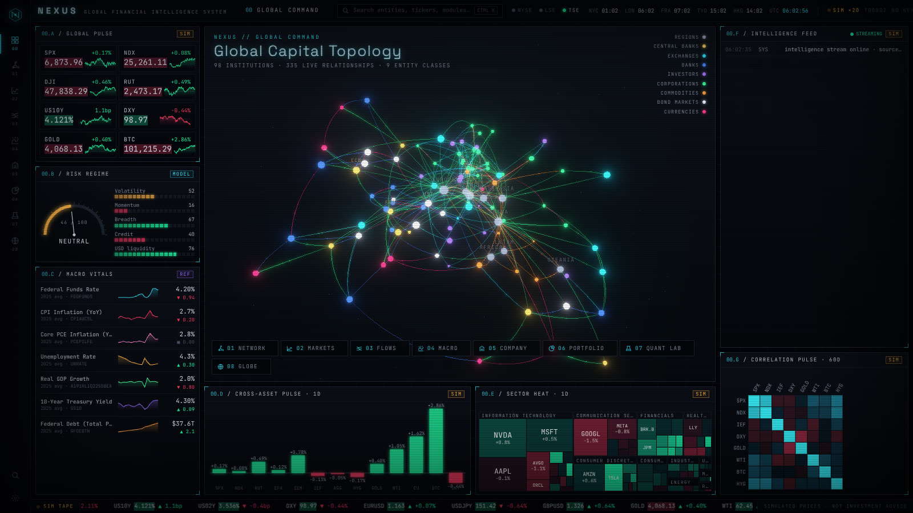

> **Data honesty.** NEXUS runs fully offline with no API keys. Every number is tagged in the UI with its source:
> `SIM` simulated by the NEXUS market engine · `LIVE` from a configured provider · `REF` bundled approximate reference data · `MODEL` computed from your inputs · `DEMO`/`USER` hypothetical portfolios. Simulated prices are never labeled live. Nothing here is investment advice.

## Quick start

```bash
npm install
npm run dev        # http://localhost:3000
# or
npm run build && npm start
```

Requires Node 20+. A GPU-accelerated browser is recommended (WebGL2).

### Optional live data

Copy `.env.example` to `.env.local` and add any of:

| Variable | Provider | Enables |
| --- | --- | --- |
| `FINNHUB_API_KEY` | [Finnhub](https://finnhub.io) | Live US equity quotes overlaid on the simulated tape (marked `LIVE`) |
| `FRED_API_KEY` | [FRED](https://fred.stlouisfed.org/docs/api/api_key.html) | Live monthly macro series in the Macro module |
| `SEC_USER_AGENT` | [SEC EDGAR](https://www.sec.gov/os/accessing-edgar-data) | Search **any** US filer in Company Intelligence (parsed from XBRL company facts). No key — the SEC requires a descriptive User-Agent with contact info. |

Keys are read only by server route handlers (`src/app/api/*`) and are never sent to the browser. The Settings drawer shows which sources are active.

## Modules

| Key | Module | Highlights |
| --- | --- | --- |
| `0` | **Global Command** | Live 3D capital topology, risk-regime gauge (vol / momentum / breadth / credit / USD), macro vitals, cross-asset pulse, streaming intelligence feed, 60-day correlation matrix |
| `1` | **Global Financial Network** | 98 institutions (central banks, exchanges, banks, investors, corporations, commodities, bond markets, currencies, regions) and 335 typed links. Four animated layouts (force, orbital, geo, strata), shader-driven capital-flow particles, filters, entity intelligence panel, systemic-importance ranking and a **contagion simulator** that propagates a shock through the graph |
| `2` | **Global Markets** | Indices, rates, FX, commodities, crypto; OHLC chart with MA20/50, Bollinger, RSI pane and visible-range volume profile; live sector treemap (1D–1Y); breadth (A/D line, % above 50DMA, McClellan); VIX term structure and realized vs implied vol |
| `3` | **Capital Flow Intelligence** | Animated Sankey (allocators → vehicles → asset classes) that morphs between Risk-On / Risk-Off / Inflation / Easing regimes, weekly fund-flow streamgraph, animated Relative Rotation Graph of sectors |
| `4` | **Macroeconomic Command** | Fed funds, CPI, core PCE, unemployment, GDP, 2Y/10Y, sentiment, debt, Fed balance sheet (1990–2025) with recession shading and z-score mode; interactive yield curve; **3D yield-curve surface**; business-cycle clock; relationship explorer (OLS, lags); Taylor-rule monitor |
| `5` | **Company Intelligence** | 10 companies × 5 fiscal years: income-statement waterfall, balance-sheet identity, DuPont ROE, margins, growth/CAGR, ROIC, EV/EBITDA, peer map. Student mode shows every formula |
| `6` | **Portfolio Intelligence** | Add/remove/import holdings, sunburst allocation, NAV vs 60/40 or S&P, drawdown, rolling vol, Sharpe/Sortino/beta/VaR/CVaR, risk contribution, look-through sector & geography, correlation matrix |
| `7` | **Quant Lab** | Monte Carlo (up to 20,000 paths, optional fat tails), long-only efficient frontier with tangency portfolio and CML, DCF with CAPM WACC builder and WACC × g sensitivity grid, historical & custom stress scenarios on your portfolio, two-asset correlation lab, compounding calculator |
| `8` | **Global Economic Map** | 3D globe of ~11k land dots, borders, financial-center beacons, animated great-circle trade corridors, commodity producers, choropleth (GDP, growth, inflation, policy & real rates, unemployment, debt/GDP), click-to-fly country intelligence |

System features: command palette (`Ctrl/⌘ K` or `/`), number-key module navigation, full-screen expansion on any panel (`⤢`, `Esc` to exit), four themes (Spectral, Magenta Desk, Phosphor, Arctic), CRT scanlines, bloom and particle-density controls, cinematic boot sequence and module transitions.

| | |
| --- | --- |
| 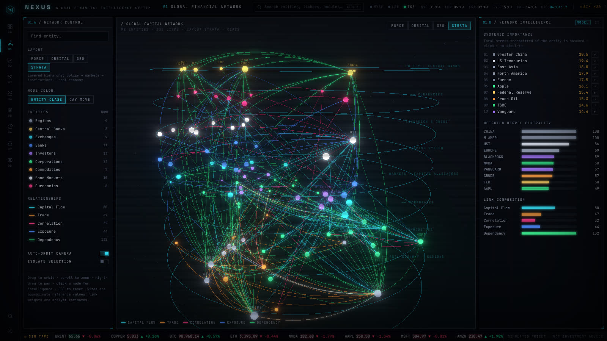 | 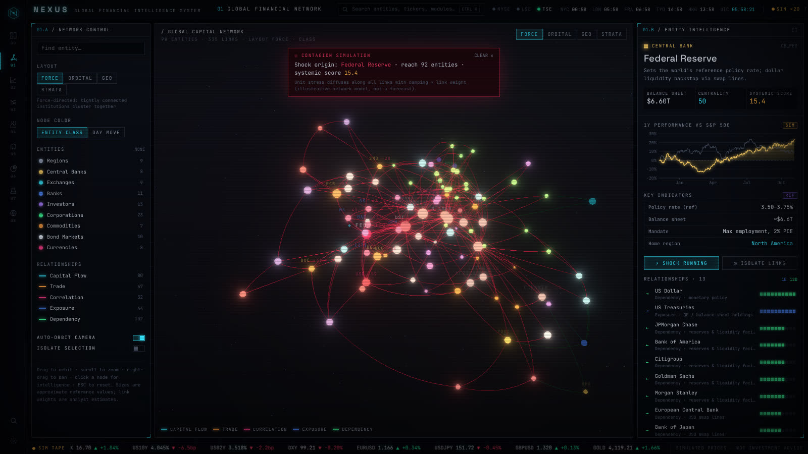 |
| 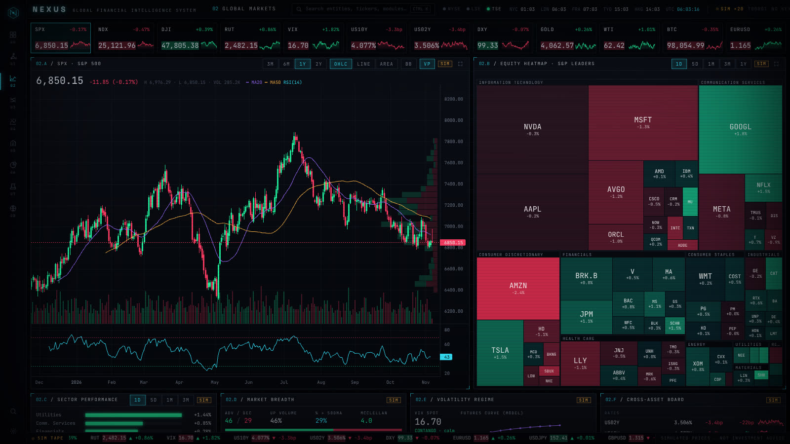 | 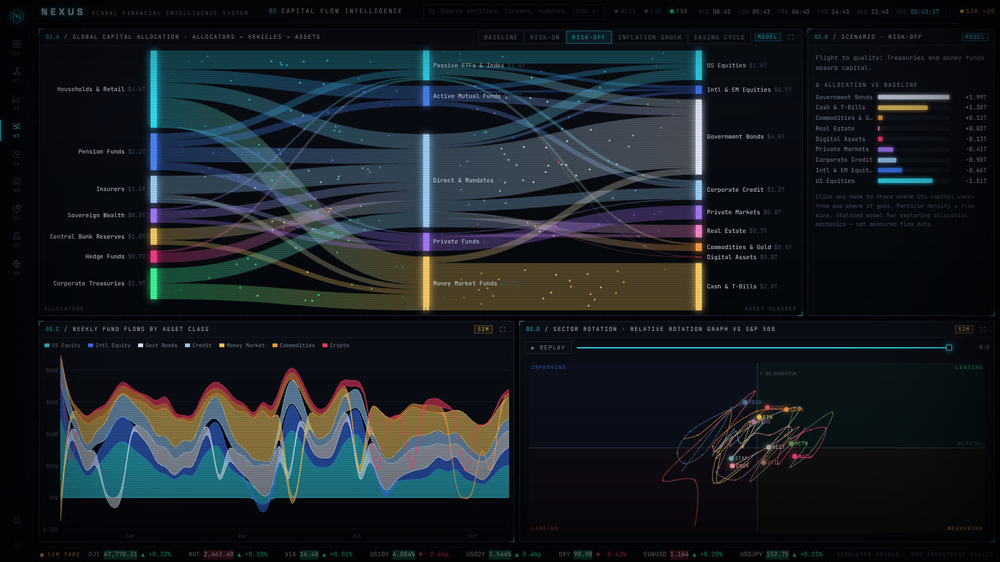 |
| 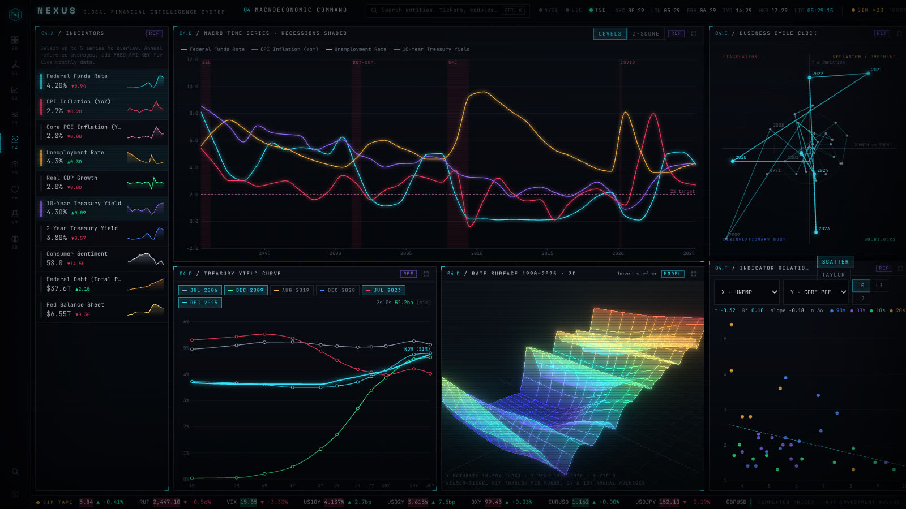 | 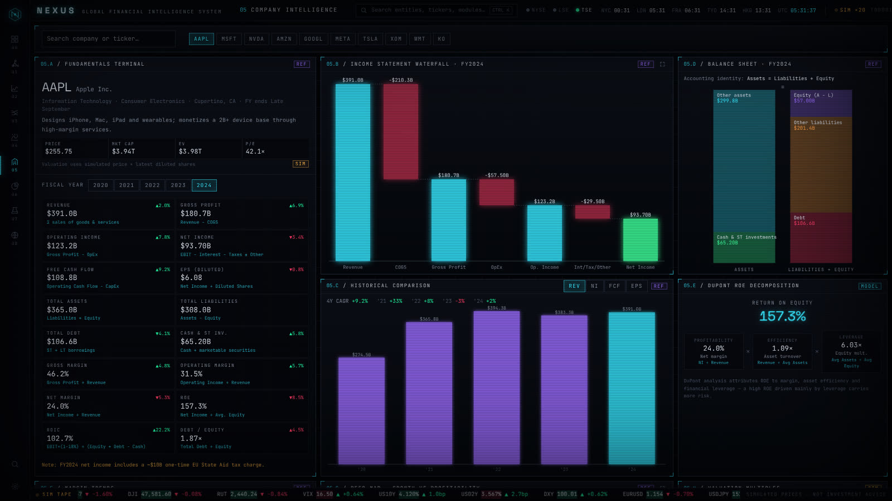 |
| 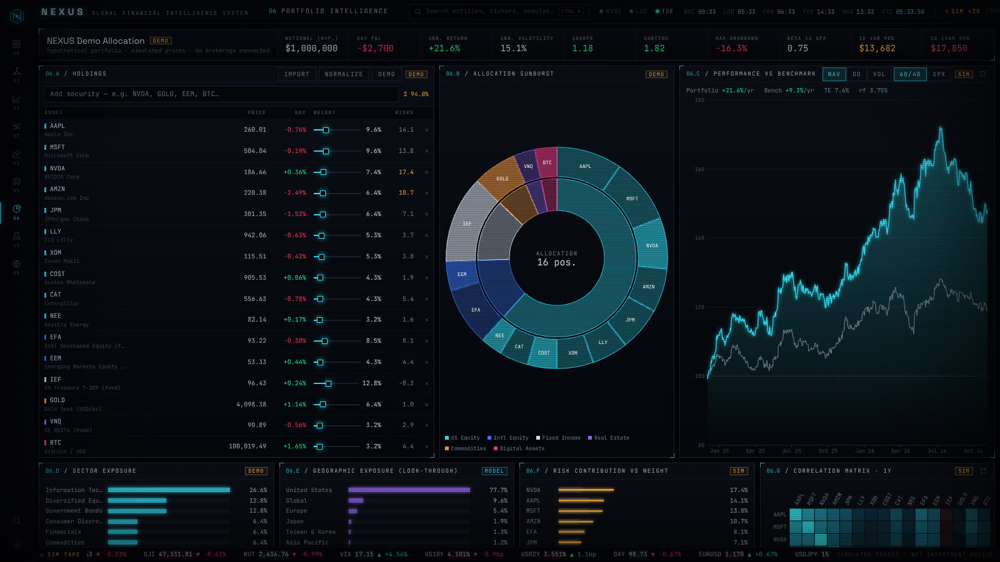 | 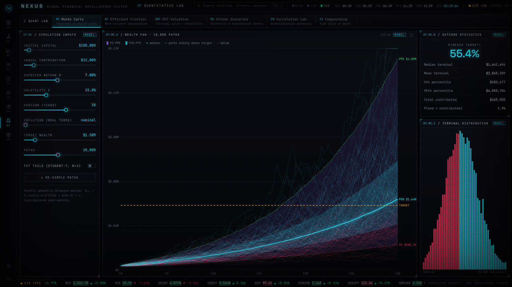 |
| 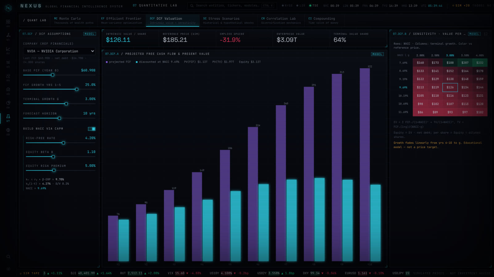 | 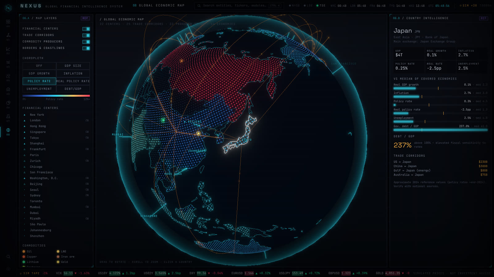 |

## How the data works

- **Market engine** (`src/lib/sim/engine.ts`): a 17-factor model (market, growth, rates, commodities, USD, crypto + 11 sectors). Each instrument's returns are a mix of shared factor shocks and idiosyncratic noise, so correlations between assets are coherent (tech moves together, gold vs the dollar, bonds vs rates). It generates two years of daily OHLCV history and an intraday tape running at 20× speed with mean reversion. Reference price levels are illustrative inputs, not quotes.
- **Reference data** (`src/lib/data/*`): rounded public figures — US macro annual averages, 10-K financials, approximate country indicators, institution sizes. Each file states its vintage. Verify before relying on them.
- **Models** (`src/lib/finance/*`): GBM Monte Carlo, projected-gradient mean–variance optimization, DCF, stress mapping, portfolio risk decomposition. Formulas are shown in the UI.

## Architecture

```
src/
  app/                 Next.js App Router — one route per module, API route handlers for live data
  components/
    shell/             Nav rail, top bar (world clocks, sessions), ticker, command palette, settings, boot
    network/           R3F network scene, layouts, intelligence panel
    globe/             R3F globe scene and module
    modules/           Markets, Flows, Macro, Company, Portfolio, Quant, Command
    charts/            D3/SVG chart primitives (line, bars, heat matrix, gauge)
    ui/                Panel chrome, controls, source tags, tooltip
  lib/
    sim/               Market simulation engine + analytics
    data/              Universe, network, macro, companies, geo, flows datasets
    finance/           Portfolio analytics and quant models
    store/             Zustand stores (market feed, settings, portfolio, UI)
```

Heavy WebGL modules are code-split and only load on the routes that need them.

## Known limitations

- Designed for desktop/laptop screens (≥1280px wide); small screens are not optimized.
- Simulated data resets its intraday state on reload; the daily history is deterministic per calendar day.
- Exchange holidays are not modeled in the session indicators.
